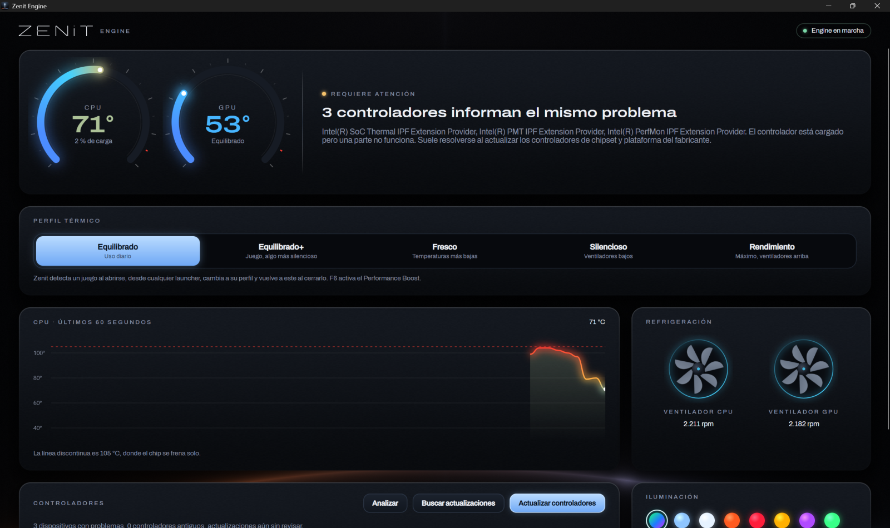

# Zenit Engine

[](https://github.com/bernaljeanp/zenit-engine/actions/workflows/build.yml)
[](LICENSE)

**Drivers, temperatures and performance for gaming laptops, from official sources only.**
Free and open source. Early version, tested on Alienware laptops; more brands are next.



My Alienware 16X Aurora sat at **104 °C doing nothing** for two days, fans roaring, and the manufacturer's app
said nothing. Zenit Engine found the cause (a power plan that never let the CPU slow down, plus a stuck state)
and the laptop went back to **58-66 °C at idle**. That is the idea: tell you what is wrong, in plain words.

## What it does

- **Thermal profile per game, automatic.** Start a game from any launcher (Steam, Epic, GOG, Xbox, Ubisoft, Riot)
  and Zenit switches to performance (balanced-performance on battery), or to the profile you picked for that game;
  quit and it restores what you had. It costs nothing while you play: a process list every few seconds, each new
  process checked once by its folder. Alienware Command Center's process monitor ran a WMI query for every process
  start and stop instead, and kept a CPU core and a half busy on the test laptop.
- **Live readings and a plain-language diagnosis.** CPU and GPU temperature, fan speeds and the active profile, read
  from the laptop's own firmware interface. When the CPU runs hot while doing little, Zenit names the process behind
  it and offers to stop it.
- **Lighting without Alienware Command Center.** Keyboard and logo color, brightness and the Aurora color drift,
  sent straight to the AlienFX "AW-ELC" controller over USB HID and restored at sign-in. Protocol from
  [alienfx-tools](https://github.com/T-Troll/alienfx-tools) (MIT).
- **The Alienware function keys keep working.** F6 Performance Boost, F7 Stealth and F9 keyboard light levels used
  to need Alienware Command Center; the firmware sends them as hidden F17-F20 keys, and Zenit handles them and shows
  a short on-screen notice.
- **In the tray.** Starts with Windows next to the clock: temperatures in the tooltip, profiles one click away.
- **An instrument cluster, not a settings page.** Heat dials, a mode bar, the last minute of CPU heat and the fans,
  drawn on the GPU with Skia shaders. It watches its own cost: shader layers are cached on the GPU, about 15 % of one core while focused, nothing in the tray.
- **Speaks your language.** English or Spanish, picked from the Windows display language, notices included.
- **Driver updates, official sources only.** Lists devices Windows reports as failing (error codes, "Degraded")
  and vendor drivers for physical hardware older than three years. **Update drivers** installs official updates from
  two places: the Windows Update driver catalog (packages Intel, NVIDIA, Dell and the other makers publish for your
  exact hardware IDs, signed by Microsoft) and, on Dell and Alienware, Dell's own catalog for your model, the one Dell
  Command Update reads. Every Dell package must match the SHA-256 in Dell's signed catalog and carry Dell's signature.
  Only versions newer than the one installed qualify. A restore point is created first, and nothing installs until
  you press the button.
- **Works on any PC, best on Alienware.** Without a supported laptop it falls back to the Windows power mode.

## What it will never do

- Install drivers from its own mirror or a scraped database. Tools that do this have shipped wrong and generic drivers.
- Load a third-party kernel driver. On Alienware it talks to Dell's own AWCC WMI interface, the one Alienware
  Command Center uses, so anti-cheat and Windows security are unaffected.
- Touch games or anti-cheat, or send data anywhere. No telemetry, no ads, no bundled software.

## Supported laptops

| Brand | Status |
|---|---|
| Alienware (2020 and newer, AWCC WMI) | Working: profiles, fans, temperatures. Tested on a 16X Aurora (2025). |
| Dell (all models in Dell's catalog) | Driver updates from Dell's catalog. Thermal control likely on Dell G (same interface), untested. |
| Lenovo, HP, MSI, ASUS, Acer | Driver updates through Windows Update. Maker catalogs and thermal control planned. [Request your model](../../issues/new?template=laptop-support.yml). |
| Others | The Windows power mode fallback and the driver check work on any Windows PC |

## Install

Requires Windows 10 version 2004 or Windows 11, and the [.NET 10 SDK](https://dotnet.microsoft.com/download) to build.

```powershell
git clone https://github.com/bernaljeanp/zenit-engine.git
cd zenit-engine
.\install.ps1          # asks for admin once
```

It publishes a self-contained build to `%LOCALAPPDATA%\Programs\ZenitEngine` and registers the Engine to start
at sign-in, and adds **Zenit Engine** to the Start menu. To remove it: `.\install.ps1 -Uninstall` (your per-game profiles in `%LOCALAPPDATA%\Zenit` are kept).

## Command line

Everything the app shows is also available as JSON:

```powershell
$z = "$env:LOCALAPPDATA\Programs\ZenitEngine\ZenitEngine.exe"
& $z --thermal                       # profiles, fans and temperatures as JSON
& $z --thermal performance           # switch the thermal profile
& $z --drivers                       # driver check (add --offline to skip Windows Update)
& $z                                 # installed games (Steam, Epic, GOG, Xbox, Ubisoft, Riot) as JSON
& $z --launch steam:730              # launch with the game's thermal profile; restores the previous one on exit
& $z --lights 8EC5FF 80              # keyboard and logo color (RRGGBB or AURORA) and brightness (0-100)
& $z --game-profile steam:730 quiet  # remember a profile for a game
```

## How it works

- `ZenitEngine --serve` is the Engine. A scheduled task starts it elevated at sign-in (no console window, no UAC
  prompt at each sign-in). It answers on the local named pipe `ZenitEngine`, which only the current user can open,
  so nothing else in the program needs admin rights.
- Thermal control lives in [`Thermal.cs`](src/ZenitEngine/Thermal.cs). The AWCC opcodes come from the Linux kernel's
  [Dell AWCC WMI documentation](https://docs.kernel.org/wmi/devices/alienware-wmi.html).
- The driver check lives in [`Drivers.cs`](src/ZenitEngine/Drivers.cs): a WMI device inventory plus the Windows
  Update Agent API, search only.
- `ZenitEngine --selftest` runs the parser and policy checks; CI runs it on every push.

## Contributing

The most useful contribution is a **brand connector**: the WMI or ACPI calls a laptop uses for its thermal
profiles and fans, documented and tested on real hardware. Start with a
[laptop support request](../../issues/new?template=laptop-support.yml). Security issues: see [SECURITY.md](SECURITY.md).

## Support the project

Zenit Engine is free. If it helped your laptop, you can support its development with the **Sponsor** button
on this page.

## License

[GPL-3.0](LICENSE). Not affiliated with Dell, Alienware, Lenovo, ASUS, HP, MSI, Acer, Microsoft or any other
brand named here; their names only identify the hardware and software it works with.
